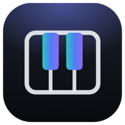
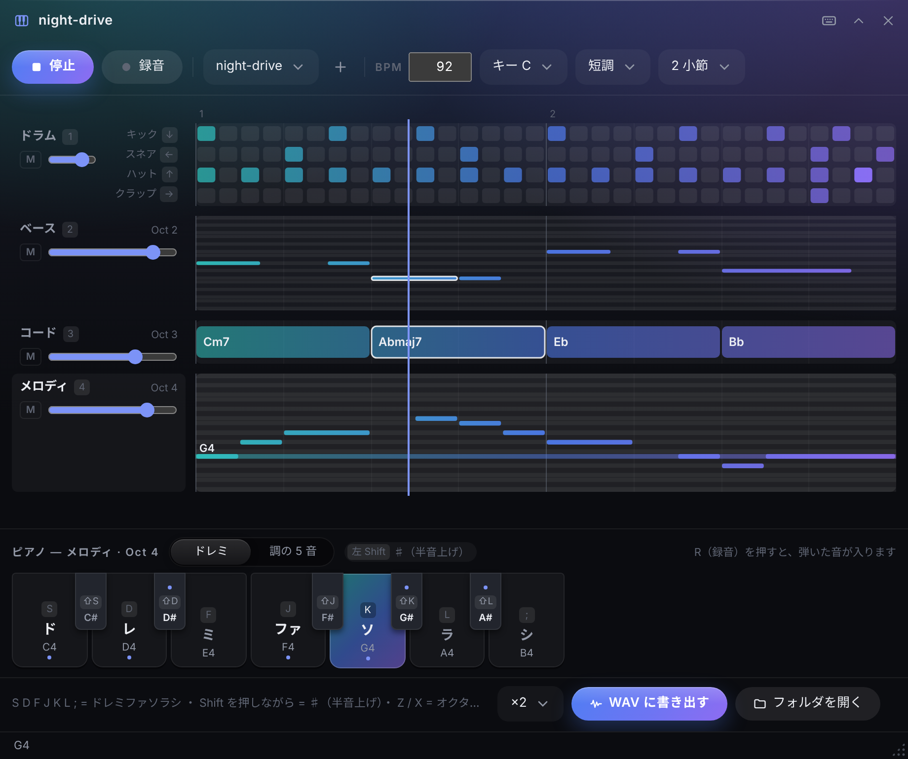
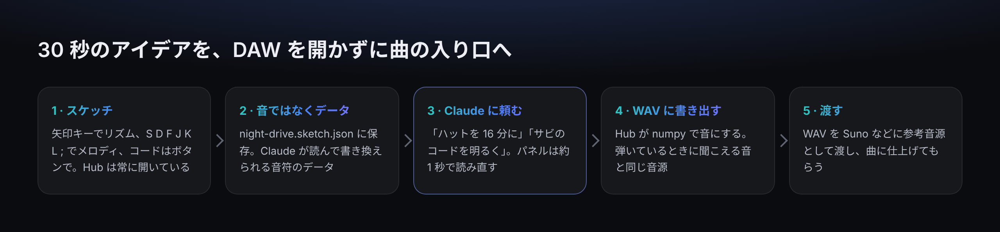
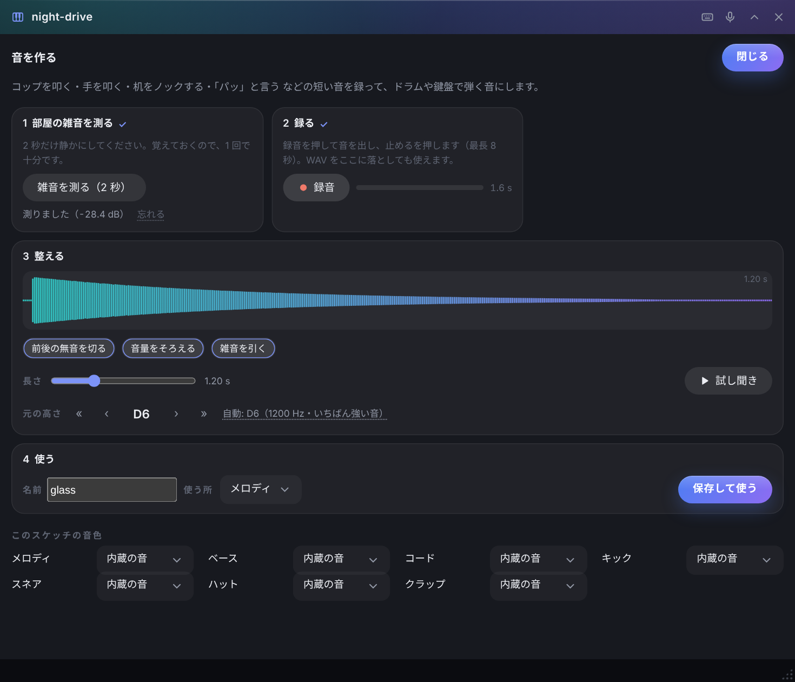

<p align="center"></p>

# Sound Sketch（サウンドスケッチ）

<p align="center"><a href="README.md">English</a> · <b>日本語</b></p>

画面の端に常駐するデスクトップの作業台 **[Hub](https://github.com/satosugarforwork44x-lang/desktop-hub)** の拡張アプリです。
**PC のキーボードで**ドラム・ベース・コード・メロディを数小節だけ作り、**Claude** にデータとして直してもらい、
WAV に書き出して **Suno** などの音楽生成 AI に渡します。DAW は開きません。
コップを叩いた音、電話越しの声、自分の動画の環境音を録れば、それを鍵盤で弾く楽器にもできます。



> ライセンス: [PolyForm Noncommercial 1.0.0](LICENSE) — 個人利用など、営利目的でなければ自由に使えます。

## 作った理由

私は AI で音楽を作りますが、DAW は使いません。これまでは、リズムを考える → Claude に numpy のコードを書いてもらって音にする →
それを参考音源として Suno に渡す、という流れでした。これでも作れますが、少し直すたびにコードを書き直し、音を作り直し、そのたびに音も少し変わります。

必要だったのはスタジオではなく、**スケッチ帳**でした。

- **すぐ開ける。** アイデアは数秒で消えます。サウンドスケッチは、画面の端に常にある Hub の中にあるので、ワンクリックで開けます
- **プログラムせず、弾く。** リズムは矢印キー、メロディはホームポジション、コードはボタン。音楽理論を知らなくても始められます
- **データのまま持つ。** スケッチは音ではなく、音符の小さな JSON です。Claude が読んで直せます（「ハットを 16 分に」）。直すとパネルがすぐ読み直します
- **毎回同じ音。** 音は Hub が 1 つの numpy の音源で作ります。弾いているときに聞こえる音が、そのまま書き出されます



## UX で決めたこと

キーの並びは、実際に使いながら何度か作り直しました。何をどう決めたか、その理由です。

| 決めたこと | 理由 |
|---|---|
| **音は `S D F J K L ;`、半音は左 Shift を押しながら** | ホームポジションの 7 キーがドレミファソラシ。最初の版は右手の 5 キーだけで、ラとシに届きませんでした。両手を使い、左手の小指は Shift に空けておくことで、手を動かさずに ♯ まで弾けます |
| **ドラムは矢印キー** | どのキーボードにもあり、音のキーとぶつかりません。メロディを選んでいる間もドラムを叩けます |
| **パートは `1 2 3 4`、再生は `Space` / `Enter`** | 音のキーとぶつからないよう、ホームポジションから外しました |
| **ミニ鍵盤を常に表示** | 最初の感想は「ピアノがどこにあるかわからない」でした。下の帯に、どのキーで何の音が鳴るかを出し、押した音を光らせ、今の調の音には点を付けます |
| **コードは I〜VII のボタン** | その調に合うコード（Cm・Ddim・Eb …）から選ぶだけ。Shift を押しながらで 7th。クリックするとカーソルの位置に置けます |
| **2 つの入れ方** | 再生しながら **G**（録音）：叩いた音を 16 分音符のマスにそろえて記録。止まっているとき：音がカーソル（▼）の位置に入り、カーソルが進む（文字を打つ感覚）。**Space** で休み、**Backspace** で消して戻る。進む幅は 16 分・8 分・4 分。ドラムは同時に押せば同じマスに入る |
| **録音は G** | 最初は R でしたが、ホームポジションから遠い。G なら左手の人差し指のとなりで、手を動かさずに切り替えられます |
| **「調の 5 音」モード** | どのキーを押してもペンタトニックの音になるので、外れた音が鳴りません。最初のアイデア出しに |
| **リズムのプリセット** | 8 ビート・16 ビート・4 つ打ち・ロック・ヒップホップ・バラード・レゲエ・ボサノバ・ファンク。ノリから選んで直す |
| **コードは半小節単位** | 1 小節に 1 コードがいちばん多く、次が 2 コード。小節の前半を押すと小節全体に、後半を押すと小節を 2 つに分けて置きます（4 拍目だけに入ってしまうことがない） |
| **消しやすく** | 右クリックで、マス・音符・コードを消せます。音符は 1 行ずれても当たり。パートごとの 🗑 で全部消せます。行は窓の高さに合わせて広がり、押しやすくなります |
| **参考の音** | 鼻歌や声、録音（Hub のレックスケッチで雑音を消したものなど）の WAV をパネルに落とすと、スケッチと一緒にループで鳴ります。自分の声に合わせて弾けます。波形をドラッグして頭を合わせ、ダブルクリックで音の出だしに合わせます。書き出す WAV にも混ざります |
| **自分の音を 4 つの手順で** | コップを叩く・手を叩く・「パッ」と言う音をマイクで録って、鍵盤やドラムのパッドで鳴らせます。手順を 1 → 4（雑音を測る・録る・整える・使う）と並べたので、覚えることがありません。前後の無音・音量・部屋の雑音は自動で整え、**元の高さも自動で調べる**ので、鍵盤で弾くと正しい高さで鳴ります（倍音のそろった音は YIN、ガラスなど叩いた音はいちばん強い音。ずれて聞こえたら ‹ › で直す）。**マイクと PC の音は別々に録る**（レックスケッチと同じ）ので、電話越しの声や自分の動画の環境音も使えます。どちらを使うかは録ったあとで「マイク / PC の音 / 両方」から選びます。サウンドスケッチだけで動くので、レックスケッチを入れていなくても使えます |
| **今鳴っている音が見える** | 押した音の行が光り、再生中は鳴っている音符・コードが縁取られます |
| **なくさない** | `Ctrl+Z` で元に戻せます。WAV は上書きしません（`name (2).wav`）。外（Claude）で直した内容は自動で読み直します |
| **キーは変えられる** | キーは刻印ではなく物理的な位置（`KeyboardEvent.code`）で持つので、JIS と US で同じ位置になります。テンキー用のプリセットもあります |

## できること

| 機能 | 内容 |
|---|---|
| **4 つのパート** | ドラム（キック・スネア・ハット・クラップ。Shift でアクセント）・ベース・コード・メロディ。1 / 2 / 4 / 8 小節、BPM 40〜240、調と長調 / 短調 |
| **ミキサー** | パートごとの音量とミュート |
| **マウスでも** | マスや音符を押して足す・消す。コードの行を押してコードを選ぶ |
| **参考の音** | 保存先フォルダの WAV（パネルに落としたものも）を一緒に鳴らし、書き出しにも混ぜる |
| **音を作る** | 短い音を録って（WAV を落としても可）整え、ベース・コード・メロディ・ドラムのどれかの音にする。スケッチの隣の `samples/` に保存し、弾くときも書き出しにも使う |
| **書き出し** | WAV（44.1 kHz・16 bit）。×1 / ×2 / ×4 / ×8 の繰り返し。スケッチと同じフォルダに保存 |
| **Claude 連携** | スケッチのフォルダを Hub の MCP 設定で Claude に共有すると、Claude が `SKETCH_FORMAT.md` を読んで JSON を直します |
| **日本語と英語** | 画面は日本語と英語の両方に対応 |



## はじめかた

**Hub 0.7 以上**（バーの鍵盤アイコンは 0.7.5 以上）と **numpy** が必要です。自分の音を録るには **soundcard** も使います（任意。無くても WAV を落とせば使えます）。

1. このリポジトリを、Hub のモジュールのフォルダに **`sketch` という名前で**置きます（フォルダ名とモジュールの id を合わせる必要があります）。
   ```bat
   git clone https://github.com/satosugarforwork44x-lang/sound-sketch "%LOCALAPPDATA%\Hub\modules\sketch"
   py -m pip install --user -r "%LOCALAPPDATA%\Hub\modules\sketch\requirements.txt"
   ```
2. Hub を再起動すると、バーに **サウンドスケッチ** が出ます。
3. スケッチの保存先にするフォルダを、パネルに落とします。Hub のフォルダ窓の場所の中のフォルダ
   （例: `C:\Users\you\Hub\Sound Sketch`）がおすすめです。フォルダ窓にもなります。
4. （任意）Claude に直してもらうなら: Hub の設定（⚙）→ Claude との連携 → そのフォルダ窓を **読み書き** にします。
5. （任意）録音するなら: Windows の 設定 → プライバシーとセキュリティ → マイク で、**デスクトップ アプリ** にマイクを許可します。

## キー

```
 中段:  [Shift]  S   D   F    J    K   L   ;
                 ド  レ  ミ   ファ  ソ  ラ  シ        Shift を押しながら = ♯
```

| キー | 動作 |
|---|---|
| `S D F J K L ;` | ドレミファソラシ。コードのパートでは I〜VII |
| 左 `Shift`（押している間） | ♯（半音上げ）。コードでは 7th |
| `Z` / `X` | オクターブ下 / 上 |
| `←` `↓` `↑` `→` | スネア / キック / ハット / クラップ（Shift でアクセント） |
| `Space` / `Enter` | 再生 / 停止 |
| `G` | 録音。再生中は叩いた音をマスにそろえて記録、止まっているときはカーソルの位置に入れて進む |
| `Space` / `Backspace` | 書き込み中（止めて録音）: 休み（1 つ進む）/ 1 つ戻って消す |
| `Tab` | ドレミ（ふつうの鍵盤）/ 調の 5 音（外れない音だけ） |
| `1` `2` `3` `4` | パート: ドラム / ベース / コード / メロディ |
| `Ctrl+Z` | 元に戻す |

キーは、パネルの見出しの鍵盤ボタンからすべて変えられます。

## Claude と使う

スケッチのフォルダを共有すると、Claude Desktop で次のように頼めます。

- 「サウンドスケッチの `night-drive` のハットを 16 分にして、最後の 1 つを強くして」
- 「コードに合わせたベースを、1 拍に 1 音で足して」
- 「夜のドライブっぽい、ハ短調の 4 小節のコード進行を書いて」

Claude は [`SKETCH_FORMAT.md`](SKETCH_FORMAT.md)（保存先フォルダに自動で置かれます）を読んで、JSON を書き換えます。
パネルは約 1 秒で変更に気づきます。Claude が音のコードを書く必要はなく、音にするのは Hub です。

## しくみ

| ファイル | 役目 |
|---|---|
| `manifest.json` | Hub のモジュール定義（`moduleApi 1`）。パネル・タイルのアイコン・公開する関数・音の受け渡し（`/blob/sketch/…`） |
| `api.py` | スケッチの保存と検査（読めない所は警告を出して読み飛ばす）、壊れない書き込み、上書きしない WAV の書き出し、キーの割り当ての保存 |
| `synth.py` | numpy の音源。ドラム・ベース・パッド・リードの音、音名とコードの読み取り、ミックス |
| `mic.py` | 短い音を録る。既定のマイクと PC の音（ループバック）を同時に・別々に（別スレッド・soundcard / WASAPI・メモリの中だけ） |
| `sampler.py` | 録った音を整える。スペクトル減算で雑音を引く・前後の無音を切る・長さとフェード・音量・元の高さ（YIN と、いちばん強い音） |
| `ui/panel.js` | パネル。Canvas の各パート、ミニ鍵盤、録音、Web Audio での再生、キーの処理 |
| `ui/sampler.js` | 「音を作る」の画面（4 つの手順・波形・元の高さ・音色の割り当て） |
| `ui/theory.js` | 調・音階・その調のコード（`synth.py` と同じ決まり） |
| `ui/keys.js` | キーの既定の割り当て・プリセット・表示名 |
| `SKETCH_FORMAT.md` | スケッチの形。Claude に向けて書いたもの |

- **1 つの音源を 2 つの用途に。** 弾いているときは、パネルが Hub に 1 音ずつ（`v-lead-67.wav` など）頼みます。Hub は `synth.py` で 1 回だけ作ってためておき、
  ブラウザが Web Audio で並べて鳴らします。書き出しは、同じ関数でスケッチ全体を音にします
- **録った音も、ただの音色の 1 つ。** 鍵盤で弾くと、元の高さから速さを変えてずらします（昔のサンプラーと同じ）。内蔵の音と同じしくみで `s-<枠>-<ずらす半音>-….wav` として 1 回だけ作り、ためておきます
- **データが正。** スケッチのファイルだけが正しい中身です。パネルは更新時刻を見ているので、Claude やテキストエディタで直した内容がそのまま出ます
- **Hub 本体はほぼそのまま。** 通常の Hub のモジュールとして作っています（Hub に足したのはバーのアイコン 1 つだけ）

## 確かめ方

```bat
py -m unittest discover -s tests -v
```

## ライセンス

**[PolyForm Noncommercial 1.0.0](LICENSE)** — **個人・学習・研究など、営利目的でない利用**は、使う・読む・直す・配るのが自由です。
商用利用（販売、有料の製品やサービスへの組み込み、営利目的の仕事での利用）はできません。商用で使いたい場合は作者に連絡してください。

| ライブラリ | 用途 | ライセンス |
|---|---|---|
| numpy | 音源 | BSD-3-Clause |
| soundcard（任意） | マイクからの録音 | BSD-3-Clause |

ロゴ（`assets/`）も、このリポジトリと同じライセンスです。
