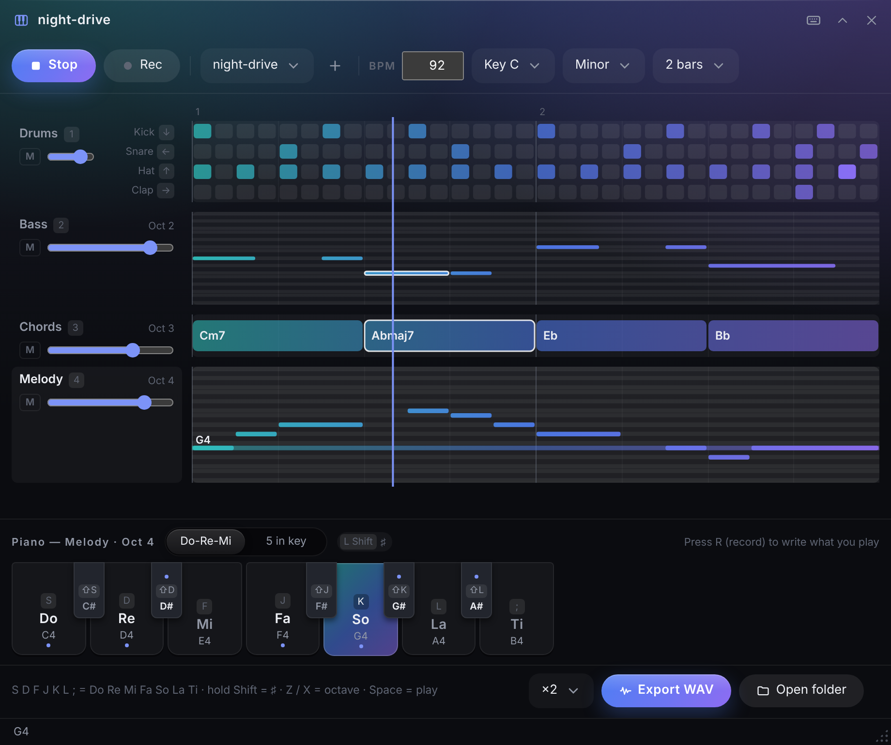
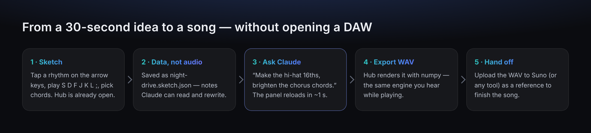

<p align="center"></p>

# Sound Sketch

<p align="center"><b>English</b> · <a href="README.ja.md">日本語</a></p>

An extension app for **[Hub](https://github.com/satosugarforwork44x-lang/desktop-hub)**, the slim bar on the edge of your Windows desktop.
Sketch a few bars of drums, bass, chords and melody **from your computer keyboard**, let **Claude** rewrite them as data,
and export a WAV to hand to an AI music tool such as **Suno** — without ever opening a DAW.



> License: [PolyForm Noncommercial 1.0.0](LICENSE) — free for personal and other non-commercial use.

## Why I built this

I make music with AI, but I don't use a DAW. My routine was: come up with a rhythm, ask Claude to write numpy code that turns it into audio,
then upload the result to Suno as a reference. It worked, but every small change meant new code, a new render and a slightly different sound.

What I actually needed was a **sketchpad**, not a studio:

- **Open instantly.** Ideas last seconds. Sound Sketch lives in Hub, which is always on the screen edge — one click, no app to launch.
- **Play it, don't program it.** Rhythm on the arrow keys, melody on the home row, chords as buttons. No music theory needed to get started.
- **Keep it as data.** A sketch is a small JSON file of notes, not audio. Claude can read it and change it ("make the hats 16ths"), and the panel reloads.
- **Same sound every time.** Hub renders audio with one numpy engine. What you hear while playing is exactly what gets exported.



## UX decisions

The layout went through several rounds of real use. The table shows what was chosen and why.

| Decision | Why |
|---|---|
| **Notes on `S D F J K L ;`, hold left Shift for ♯** | 7 keys = Do Re Mi Fa So La Ti on the home position. The first version used only 5 keys under the right hand, so La and Ti were out of reach. Using both hands and keeping the left pinky on Shift gives a full scale with sharps, without moving the hands |
| **Drums on the arrow keys** | Every keyboard has them, and they don't collide with the note keys. You can tap drums while the melody part is selected |
| **Parts on `1 2 3 4`, play on `Space` / `Enter`** | Moved off the home row so they never fight with the notes |
| **A mini keyboard is always visible** | "Where is the piano?" was the first feedback. The bottom strip shows which key plays which note, lights up what you press and marks the notes in the current key with a dot |
| **Chords as buttons I–VII** | You pick from the chords that fit the key (Cm, Ddim, Eb, …). Hold Shift for 7th chords. Clicking a chord places it at the cursor |
| **Two ways to record** | While playing with **R**: what you tap snaps to the 16th-note grid. While stopped: each note goes to the cursor (▼) and the cursor moves on — like typing |
| **"5 in key" mode** | Every key plays a note of the pentatonic scale, so nothing sounds wrong. Good for a first idea |
| **Rhythm presets** | 8-beat, 16-beat, four on the floor, rock, hip-hop, ballad, reggae, bossa nova, funk. Start from a groove, then edit |
| **You can always see what is playing** | The row of the note you press glows; during playback, sounding notes and chords are outlined |
| **Nothing is lost** | `Ctrl+Z` undo. WAV export never overwrites (`name (2).wav`). Edits made outside (by Claude) are picked up automatically |
| **Remappable keys** | Keys are stored by physical position (`KeyboardEvent.code`), so JIS and US keyboards behave the same. A numpad preset is included |

## Features

| Feature | What it does |
|---|---|
| **4 parts** | Drums (kick, snare, hat, clap — accents with Shift), bass, chords, melody. 1 / 2 / 4 / 8 bars, BPM 40–240, any key, major or minor |
| **Mixer** | Volume and mute per part |
| **Mouse editing** | Click grid cells and notes to add or remove them, click the chord lane to choose a chord |
| **Export** | WAV (44.1 kHz, 16-bit), repeated ×1 / ×2 / ×4 / ×8, saved next to the sketch |
| **Claude integration** | Share the sketch folder with Claude through Hub's MCP settings. Claude reads `SKETCH_FORMAT.md` and edits the JSON |
| **English & Japanese** | The panel is available in both languages |

## Getting started

Requires **Hub 0.7 or later** (0.7.5+ for the keyboard icon on the bar) and **numpy**.

1. Put this repository into Hub's module folder **as `sketch`** (the folder name must match the module id):
   ```bat
   git clone https://github.com/satosugarforwork44x-lang/sound-sketch "%LOCALAPPDATA%\Hub\modules\sketch"
   py -m pip install --user -r "%LOCALAPPDATA%\Hub\modules\sketch\requirements.txt"
   ```
2. Restart Hub. **Sound Sketch** appears on the bar.
3. Drop a folder onto the panel to keep your sketches in. A folder inside Hub's folder-panel location
   (e.g. `C:\Users\you\Hub\Sound Sketch`) is best: it also becomes a folder panel.
4. (Optional) To let Claude edit sketches: Hub Settings (⚙) → Claude integration → set that folder panel to **read & write**.

## Keys

```
 home row:  [Shift]  S   D   F    J   K   L   ;
                     Do  Re  Mi   Fa  So  La  Ti        hold Shift = ♯
```

| Key | Action |
|---|---|
| `S D F J K L ;` | Do Re Mi Fa So La Ti. In the chord part: chords I–VII |
| Left `Shift` (hold) | ♯ (half step up). In the chord part: 7th chords |
| `Z` / `X` | Octave down / up |
| `←` `↓` `↑` `→` | Snare / kick / hat / clap (Shift = accent) |
| `Space` / `Enter` | Play / stop |
| `R` | Record: while playing, taps snap to the grid; while stopped, notes go to the cursor |
| `Tab` | Do-Re-Mi (normal keyboard) / 5 in key (only notes that fit) |
| `1` `2` `3` `4` | Part: drums / bass / chords / melody |
| `Ctrl+Z` | Undo |

All keys can be changed from the keyboard button in the panel header.

## Working with Claude

With the sketch folder shared, you can ask Claude in Claude Desktop things like:

- "Open `night-drive` in Sound Sketch and make the hi-hat 16th notes with an accent on the last one."
- "Add a bass line that follows the chords, one note per beat."
- "Write a 4-bar chord progression in C minor that sounds like a night drive."

Claude reads [`SKETCH_FORMAT.md`](SKETCH_FORMAT.md) (copied into your sketch folder automatically) and rewrites the JSON.
The panel notices the change within about a second. Claude never writes audio code; Hub does the rendering.

```jsonc
{
  "format": "hub-sketch/1", "bpm": 92, "key": "C", "scale": "minor", "bars": 2,
  "drums": { "kick": "x.....x...x.....|x.....x...x..x..", "snare": "....x.......x...|....x.......x..x", "hat": "...", "clap": "..." },
  "bass":   [ {"at": 0, "note": "C2", "len": 3} ],
  "chords": [ {"at": 0, "name": "Cm7", "len": 8}, {"at": 8, "name": "Abmaj7", "len": 8} ],
  "melody": [ {"at": 0, "note": "G4", "len": 2} ],
  "mix": { "drums": {"vol": 0.8, "mute": false}, "...": "..." }
}
```

## How it works

| Piece | Role |
|---|---|
| `manifest.json` | Hub module definition (`moduleApi 1`): panel, tile icon, exported functions, `/blob/sketch/…` for audio |
| `api.py` | Saves and validates sketches (anything unreadable is skipped with a warning), atomic writes, WAV export without overwriting, key-map storage |
| `synth.py` | The numpy sound engine: drums, bass, pad and lead voices, chord/note parsing, mixdown |
| `ui/panel.js` | The panel: canvas lanes, mini keyboard, recording, scheduling with Web Audio, key handling |
| `ui/theory.js` | Keys, scales, diatonic chords — the same rules as `synth.py` |
| `ui/keys.js` | Default key map, presets, key labels |
| `SKETCH_FORMAT.md` | The format, written for Claude |

- **One engine, two uses.** For live playing, the panel asks Hub for single notes (`v-lead-67.wav`, …). Hub renders them once with `synth.py`
  and caches them; the browser schedules them with Web Audio. Export renders the whole sketch with the same functions.
- **Data first.** The sketch file is the single source of truth. The panel polls its modification time, so edits from Claude or a text editor just appear.
- **No changes to Hub's core.** Everything is a regular Hub module (only the bar icon was added to Hub's icon set).

## Development

```bat
py -m unittest discover -s tests -v
```

## License

**[PolyForm Noncommercial 1.0.0](LICENSE)** — free to use, read, modify and share for **personal, study, research and other non-commercial purposes**.
Commercial use is not permitted. For commercial use, please contact the author.

| Library | Used for | License |
|---|---|---|
| numpy | sound engine | BSD-3-Clause |

The logo (`assets/`) is covered by the same license as this repository.
